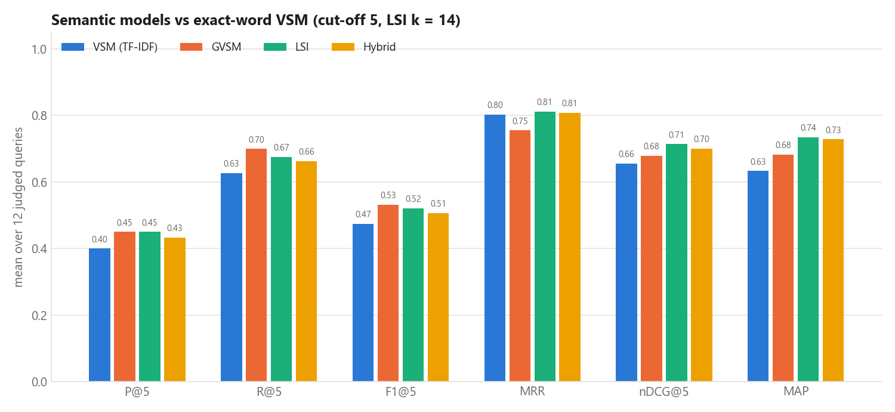
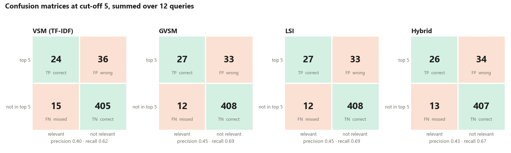
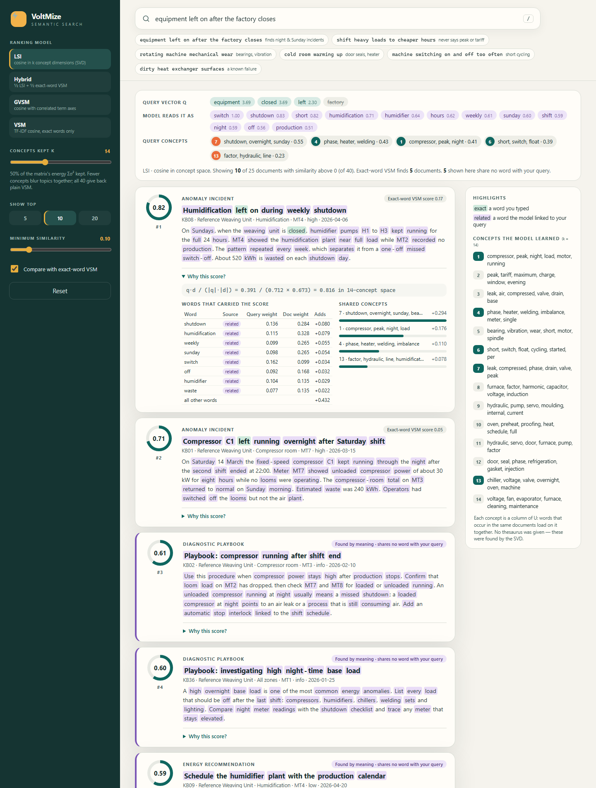

# VoltMize Week 7: Semantic Ranking Module

This folder holds the Week 7 IR case-study assignment (slide 18): a **semantic ranking module for the VoltMize FYP**. It uses the algebraic models from the lecture: a TF-IDF document-term matrix, query vectors, cosine similarity, the Generalized Vector Space Model (GVSM) and Latent Semantic Indexing (LSI) with SVD.

Like the Week 4, 5 and 6 assignments, it is standalone. It does not import, start or modify the FYP backend, frontend, database or simulator.

## The FYP problem it solves

After a VoltMize anomaly alert, an operator describes the problem **in their own words**. The report that explains it was written by someone else, using different words:

| What the operator types | What the right document says |
|---|---|
| `equipment left on after the factory closes` | "kept running through the night", "on Sundays, when the unit is closed", "after hours" |
| `shift heavy loads to cheaper hours` | "peak tariff window", "off-peak", "maximum demand" |
| `rotating machine mechanical wear` | "worn bearings", "vibration", "degradation" |
| `cold room warming up` | "door gaskets … warm air infiltrate", "defrost heater stuck on" |

Exact-word search (classical VSM) can only score a document that shares a typed word. LSI compresses the document-term matrix into **concepts**, groups of words that occur in the same documents, and compares the query and the documents by concept. Week 6 needed a hand-made thesaurus to link *overnight* and *night*. This week the link is **learned from the collection by SVD**.

## Run it

Requires Python 3.10+ with `numpy`. `matplotlib` is needed only for the evaluation charts.

```powershell
cd F:\FYP\semantic
pip install -r requirements.txt

python app.py                      # web interface -> http://127.0.0.1:8091
python cli.py "equipment left on after the factory closes" --explain
python cli.py --concepts           # the 14 concepts LSI found
python evaluate.py                 # VSM vs GVSM vs LSI vs hybrid -> results/
python -m unittest discover -s tests -v
```

## The six minimum requirements (slide 18)

| # | Requirement | Where |
|---|---|---|
| 1 | Create document-term matrix | `semantic_search/matrix.py`: A is 513 terms × 40 documents, TF-IDF `(1 + ln tf) × ln(N/df)`, columns of length 1 |
| 2 | Convert query into vector | `DocumentTermMatrix.query_vector()`: the same terms and weights; unknown words are reported |
| 3 | Calculate cosine similarity | `semantic_search/models.py`: `q̂·d̂ / (‖q̂‖ ‖d̂‖)` in term space (VSM), correlated term space (GVSM) or concept space (LSI) |
| 4 | Rank documents | `engine.py`, `search()`: sorted by cosine, with a minimum-similarity cut-off |
| 5 | Show top results | Web cards (top 5 / 10 / 20), CLI `--top` |
| 6 | Explain how semantic matching improves retrieval | Each result's **Why this score?** panel splits the cosine exactly into words and concepts, and flags "found by meaning". See [SEMANTIC_MODEL_EXPLANATION.md](SEMANTIC_MODEL_EXPLANATION.md) and the evaluation below. |

Slide 15's extra features are also covered: semantic similarity, the basic LSI idea, and matrix reduction (SVD, with a k slider). See [ASSIGNMENT_MAPPING.md](ASSIGNMENT_MAPPING.md) for how to demonstrate each one.

## Results

`python evaluate.py` runs 12 judged queries. They were written **before any model was run**, and each one deliberately avoids some of the words its relevant documents use (cut-off 5, LSI k = 14):

| Metric | VSM (exact words) | GVSM | **LSI** | Hybrid |
|---|---|---|---|---|
| Precision@5 | 0.400 | 0.450 | **0.450** | 0.433 |
| Recall@5 | 0.627 | **0.700** | 0.675 | 0.663 |
| MRR | 0.802 | 0.755 | **0.811** | 0.808 |
| nDCG@5 | 0.656 | 0.679 | **0.714** | 0.700 |
| MAP | 0.633 | 0.682 | **0.735** | 0.728 |

Against VSM on nDCG@5, LSI is **better on 5 queries, the same on 6 and worse on 1**. The clearest win is Q1 (`equipment left on after the factory closes`): nDCG went from 0.64 to 1.00 and AP from 0.32 to 0.91. LSI ranked three playbooks that share **no word at all** with the query (KB02, KB36, KB09) in its top 5.

Read the results honestly:

- **The gain is real but modest.** The collection has 40 short documents, so co-occurrence evidence is thin.
- **Two queries fail for every model.** In Q5 (`cooling plant getting too hot`), LSI links *cooling* to *pre-cooling* and the peak-tariff topic, which is the wrong sense of the word. In Q10 (`dirty heat exchanger surfaces`), the heat-recovery recommendation KB35 contains the exact words *heat exchanger* and wins under every model.
- **LSI is worse on Q11** (`motor running hot`). *Hot* is not in the vocabulary, so only *motor running* is left, and that leans towards general motor and overnight-running documents.
- **k was not tuned on these queries.** It was fixed by a rule (keep 50% of Σσ²) before evaluation. The sweep in `results/k_sensitivity.png` shows that every k from 9 to 30 gives about 0.68–0.75, and all 40 concepts reproduce plain VSM exactly.
- The judgments were written by the same author as the documents. The numbers show that the model behaves as designed, not how it would perform in production.



### Confusion matrices (cut-off 5, summed over 12 queries × 40 documents = 480 pairs)

The top 5 count as "retrieved" and every other document as "not retrieved":

| Model | TP (relevant, in top 5) | FP (irrelevant, in top 5) | FN (relevant, missed) | TN | Precision | Recall |
|---|---|---|---|---|---|---|
| VSM | 24 | 36 | 15 | 405 | 0.400 | 0.615 |
| GVSM | 27 | 33 | 12 | 408 | 0.450 | 0.692 |
| **LSI** | **27** | **33** | **12** | 408 | **0.450** | **0.692** |
| Hybrid | 26 | 34 | 13 | 407 | 0.433 | 0.667 |

- LSI and GVSM each find 3 more relevant documents in the top 5 than VSM does, and miss 3 fewer.
- GVSM and LSI have the same counts. The difference between them is the **order** inside the top 5, which nDCG and MAP measure (0.714 / 0.735 for LSI vs 0.679 / 0.682 for GVSM).
- Accuracy is about 0.90 for every model. That is because most pairs are true negatives, so accuracy is not used to compare the models.
- Per-query counts are in `results/confusion_matrix.csv`.
- **The full comparison table is in [results/comparison_table.md](results/comparison_table.md).** It has every metric for every model, the best value in bold, an "LSI − VSM" column, per-query nDCG@5 and AP tables, and win/tie/loss counts against VSM. The same summary is in `results/comparison_summary.csv`, which opens in Excel.



## Folder structure

```text
semantic/
├── app.py                       web server (standard library + numpy)
├── cli.py                       console search with --explain and --concepts
├── evaluate.py                  4 models, metrics, k sweep, charts
├── semantic_search/
│   ├── text.py                  tokenizer, stop words, light stemmer
│   ├── matrix.py                document-term matrix and query vector (requirements 1, 2)
│   ├── models.py                cosine, VSM, GVSM, LSI, hybrid, SVD (requirement 3)
│   ├── engine.py                ranking, top results, explanations (requirements 4, 5, 6)
│   └── lecture.py               slide 7-8 and slide 11-12 examples
├── data/
│   ├── knowledge_base.json      the same 40 VoltMize documents as Week 6
│   └── queries.json             12 judged vocabulary-mismatch queries
├── web/                         index.html, styles.css, app.js
├── tests/                       23 unit tests
├── results/                     evaluation output and charts
│   └── matrices/                A, U_k, σ, V_kᵀ, Σ_k V_kᵀ, A_k and concept top terms as CSV (open in Excel)
├── screenshots/                 captured from the running app
├── extracted_pages/             the lecture slides as images
├── ASSIGNMENT_MAPPING.md        requirement -> implementation -> demo step
├── SEMANTIC_MODEL_EXPLANATION.md  the models in plain language, with the maths and the quiz
└── MODEL_CODE_GUIDE.md          walk-through of the code
```

## Dataset

It is the same 40-document VoltMize knowledge base as Week 6: incidents, playbooks, maintenance logs, recommendations and meter notes for the five simulator factories and the textile fault catalogue. Reusing it keeps the weeks comparable. Week 6 matched words by spelling and a thesaurus; Week 7 matches them by learned meaning. The records are synthetic teaching data, not live readings.


